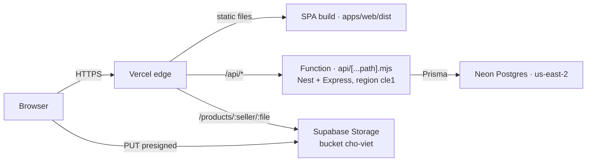

# Deploy

Bản đang chạy: **https://ecommerce-cho-viet-u3s8.vercel.app** — cả frontend lẫn API đều trên Vercel, dữ liệu ở Neon, ảnh ở Supabase Storage.

## Kiến trúc



- **Một project Vercel** `ecommerce-cho-viet-u3s8`, Root Directory = **repo root** (không phải `apps/web`). Toàn bộ cấu hình nằm trong `vercel.json`.
- **Frontend**: `pnpm --filter web build` → `apps/web/dist`, Vercel phục vụ tĩnh qua CDN. Router dùng history mode nên có rewrite về `index.html`.
- **Backend**: một Vercel Function duy nhất. `api/[...path].mjs` chỉ re-export `apps/api/dist/serverless.js` (Nest đã compile), vì esbuild của Vercel không emit decorator metadata. Handler tạo Nest app **một lần mỗi process**, gọi `app.init()` (không `listen`) rồi chuyển request cho Express.
- **Không** dùng Redis: `REDIS_URL` tồn tại chỉ vì `env.validation.ts` bắt buộc.
- **Không** dùng R2: tên biến `CLOUDFLARE_R2_*` là tên cũ, thực chất trỏ Supabase Storage qua `S3_ENDPOINT`.

## Cấu hình Vercel

`vercel.json` (đã commit, không cần sửa khi deploy):

| Khoá | Giá trị | Vì sao |
|---|---|---|
| `buildCommand` | `pnpm db:generate && pnpm --filter api build && pnpm --filter web build` | Prisma Client phải sinh trước khi build API |
| `outputDirectory` | `apps/web/dist` | thư mục tĩnh của Vite |
| `regions` + `functions["api/**/*.mjs"].regions` | `cle1` | cạnh Neon (us-east-2), nếu để mặc định thì mỗi query Prisma đi vòng |
| `functions.maxDuration` | `60` | Hobby cho tối đa 300, 60 là dư |
| rewrite 1 | `/api/:path((?!$).*)` → `/api/[...path]?__p=:path` | catch-all của function chỉ khớp **một** đoạn; handler dựng lại URL từ `__p` |
| rewrite 2 | `/products/:seller/:file` → Supabase public URL | ảnh seller upload có key `products/<sellerId>/<uuid>.jpg`; ảnh seed 1 đoạn không bị ảnh hưởng |
| rewrite 3 | `/:path((?!api/).*)` → `/index.html` | F5 ở route bất kỳ |

## Biến môi trường

Đặt trên Vercel, target **Production + Preview**.

| Biến | Ghi chú |
|---|---|
| `DATABASE_URL` | **2 record**: production → `neondb`, preview → `preview`. Chuỗi **pooled** (`-pooler`) + `?sslmode=require&pgbouncer=true&connection_limit=1` |
| `JWT_ACCESS_SECRET`, `JWT_REFRESH_SECRET`, `OPS_API_KEY` | `openssl rand -base64 48`. API từ chối chạy ở production nếu còn giá trị default dev |
| `WEB_URL` | domain site; hiện chỉ để qua validation (FE và API cùng origin) |
| `LOG_LEVEL` | `info` |
| `REDIS_URL` | `redis://localhost:6379` — giá trị giả, không có client nào dùng |
| `CLOUDFLARE_R2_ACCESS_KEY_ID`, `CLOUDFLARE_R2_SECRET_ACCESS_KEY` | S3 access key của Supabase |
| `CLOUDFLARE_R2_BUCKET_PUBLIC` | `cho-viet` |
| `CLOUDFLARE_R2_BUCKET_PRIVATE` | bất kỳ, chỉ để qua Joi (code không dùng bucket private) |
| `CLOUDFLARE_R2_PUBLIC_URL` | `https://<ref>.supabase.co/storage/v1/object/public/cho-viet` |
| `S3_ENDPOINT` | `https://<ref>.supabase.co/storage/v1/s3` |
| `S3_REGION` | `us-east-1` (không phải region của project Supabase — sai thì `SignatureDoesNotMatch`) |
| `S3_FORCE_PATH_STYLE` | `true` |
| `VITE_API_URL` | `/api` — **được nhúng lúc build**, đổi phải Redeploy |

`NODE_ENV` và `PORT` do Vercel tự inject, không set tay. `CLOUDFLARE_ACCOUNT_ID` và `JWT_*_TTL_SECONDS` có default, không cần.

## Deploy

```bash
git push origin main
```

Vercel tự build (~40 s) và promote. Không cần chạy `vercel` bằng tay.

Thứ tự build nên kiểm khi sửa `vercel.json`: `npx vercel build --prod` sẽ báo lỗi schema ngay trên máy thay vì đợi deploy.

## Migration

**Không có bước tự động.** Vercel không có `release_command`; deployment mới sẽ chạy trên schema cũ. Chạy trước khi push:

```bash
cd apps/api
DIRECT='postgresql://...@ep-xxx.us-east-2.aws.neon.tech/neondb?sslmode=require'
DATABASE_URL="$DIRECT" pnpm exec prisma migrate deploy
```

Dùng host **direct** (không có `-pooler`) cho migration; runtime thì dùng pooled.

Seed (chỉ lần đầu hoặc khi cần dữ liệu demo):

```bash
DATABASE_URL="$DIRECT" pnpm exec prisma db seed
# -> seller@choviet.local / buyer@choviet.local, mật khẩu Demo1234, 140 sản phẩm
```

Seed mất ~3 phút vì mỗi insert là một round-trip sang Ohio.

## Kiểm tra sau mỗi deploy

```bash
B=https://ecommerce-cho-viet-u3s8.vercel.app
curl -s $B/api/health/ready          # 200, database: up
curl -s $B/api/products              # 200, 24 sản phẩm
curl -s -o /dev/null -w '%{http_code}' $B/products/thia-go     # 200 html
curl -s -o /dev/null -w '%{http_code}' $B/products/dua-tre.jpg # 200 image/jpeg
```

Đăng nhập `seller@choviet.local` / `Demo1234` → Kênh bán. Upload ảnh phải hiện preview ngay (đọc từ Supabase).

## Rollback

Vercel → Deployments → deployment trước đó → ⋯ → **Promote to Production**. Không cần build lại.

## Preview deployment

Env đã tách: preview dùng database `preview` (đã migrate, **rỗng**) nên thử nghiệm không đụng dữ liệu thật. Database `preview` chưa seed; chạy `DATABASE_URL=<direct /preview> pnpm exec prisma db seed` nếu cần dữ liệu.

> Lưu ý: project hiện **không tạo preview deployment** cho branch đẩy lên (chỉ deploy `main`). Muốn bật: Settings → Git → Preview Deployments. Khi có, chúng tự dùng database `preview`.

## Sự cố đã gặp và cách nhận ra

| Triệu chứng | Nguyên nhân | Cách xử |
|---|---|---|
| Deployment `Error` ngay, không có build log | `vercel.json` sai schema (vd `includeFiles` là array) | đọc `errorMessage` ở `GET /v13/deployments/<id>`; chạy `vercel build` để bắt sớm |
| Build fail `ERR_PNPM_RECURSIVE_EXEC_FIRST_FAIL` | Root Directory không phải repo root | Settings → Root Directory = `./` |
| `/api/auth/login` trả 404 HTML, `/api/products` lại 200 | chỉ function catch-all một đoạn khớp | rewrite `__p` (đã có trong `vercel.json`) |
| Mọi request 302 "Protected by Vercel Authentication" | Deployment Protection bật cho production | Settings → Deployment Protection → tắt Vercel Authentication |
| `FUNCTION_INVOCATION_FAILED`, log `Prisma Client could not locate the Query Engine for runtime "linux-arm64-openssl-3.0.x"` | functions chạy Linux arm64 | `binaryTargets = ["native","rhel-openssl-3.0.x","linux-arm64-openssl-3.0.x"]` rồi `pnpm db:generate` |
| `Environment validation failed: "..." is required` | env chưa đặt cho target Production | thêm env rồi Redeploy |
| Ảnh upload "thành công" nhưng không hiện | bucket private, hoặc PUT bị chặn | bucket `cho-viet` phải **Public**; bản mới đã check `response.ok` nên sẽ báo lỗi |
| `SignatureDoesNotMatch` khi presign | `S3_REGION` sai | Supabase S3 dùng `us-east-1` |
| Ảnh vỡ ở `/products/<seller>/<uuid>.jpg` | thiếu rewrite 2 | kiểm tra `vercel.json` |

## Giới hạn của bản deploy này

- **Hobby chỉ cho dùng phi thương mại.** Bán hàng thật phải lên Pro ($20/seat/tháng).
- **Một function, một region** (`cle1`). Vercel tự scale nhiều instance → `ThrottlerModule` in-memory thành nhiều bộ đếm rời rạc, và mọi instance dùng chung bucket rate limit vì `trust proxy` chưa bật (mọi request mang IP của proxy).
- **Cold start ~0,6–2 s** cho request đầu sau khi instance nghỉ.
- **Migration là thao tác tay** — quên là API mới chạy trên schema cũ.
- **Token JWT nằm trong `localStorage`** → XSS đọc được refresh token.
- **Body 4.5 MB** cho mỗi request function; upload ảnh không bị ảnh hưởng vì file đi thẳng lên Supabase.
